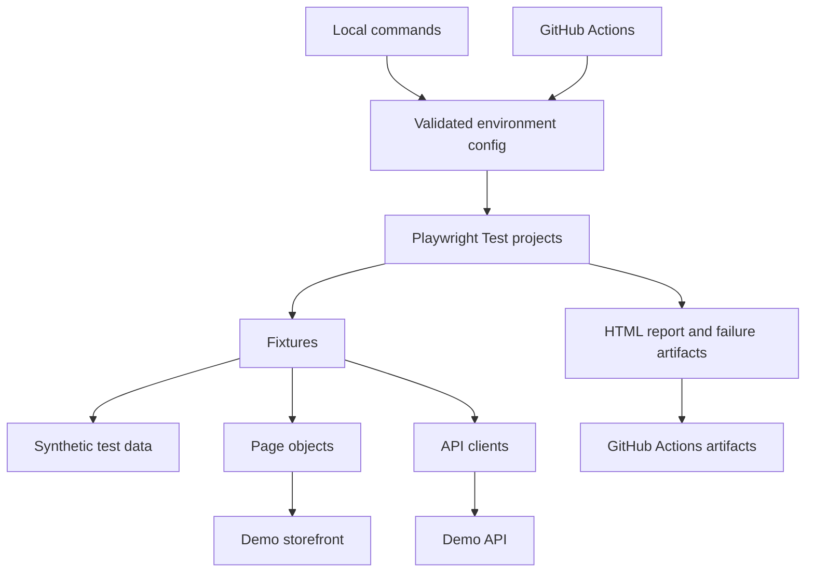

# Framework architecture

## Purpose

This repository demonstrates a maintainable Playwright + TypeScript quality gate against a deterministic demo storefront. The storefront is a training target, not a production or client system. The test framework is organized around test intent and reusable boundaries; it avoids generic abstractions that do not yet have multiple consumers.

## System view

## Component responsibilities

| Component | Responsibility | Keep out |
|---|---|---|
| `config/environment.ts` | Select local, CI, or staging target; validate `BASE_URL` before startup | Credentials and test behavior |
| `playwright.config.ts` | Runner defaults, projects, retries, artifacts, and local demo server lifecycle | Business assertions |
| `tests/` | Scenario intent and meaningful expected outcomes | Low-level duplicated page selectors |
| `src/fixtures/test.ts` | Provide focused catalog, cart, checkout, login, account, and API-client fixtures; re-export Playwright's `expect` | Unrelated global mutable state |
| `src/pages/` | Page-specific locators and user actions for catalog, cart summary, checkout, login, and account | Assertions that belong to scenario intent |
| `src/data/` | Synthetic store data and ephemeral test identities shared by scenarios | Production credentials or records |
| `src/api/store-api.client.ts` | Typed wrappers for catalog and order endpoint calls | UI navigation and scenario assertions |
| Allure reporter | Run metadata, environment context, and test attachments in `allure-results/` | Stale output from earlier runs or secrets |

## Environment selection

- `local` is the default and starts the demo app on `127.0.0.1:4173`.
- `ci` is selected automatically by GitHub Actions and starts the same demo app in the runner.
- `staging` requires an explicit `BASE_URL` and does not start the local demo app.
- `.env.example` documents local overrides. Copy it to `.env`; `.env` is ignored by Git.
- Local/CI demo auth passwords are generated randomly per run in memory. Staging credentials must be supplied through environment variables or GitHub Actions secrets. No credentials belong in source files or stored browser state committed to Git.

## Test design rules

1. Each test owns its business outcome assertions.
2. Page objects expose meaningful actions and state, not generic wrappers around every Playwright method.
3. Use API calls for setup only when they preserve the scenario's intent; verify the behavior under test through its actual interface.
4. Keep tests independent and repeatable; avoid test-order dependencies and fixed sleeps.
5. Treat retries as diagnostic signal. A test that passes only after retry is flaky and remains visible in reports.
6. Add an abstraction only when it removes real duplication or provides a clear domain boundary.

## Evolution plan

The current code includes catalog, cart, checkout, login, and account page objects; typed API fixtures; centralized synthetic data; session and authorization checks; and Allure result generation. UI and API scenarios use these boundaries while assertions remain in tests. Follow-up milestones will improve authentication reuse for parallel runs and add richer CI evidence. Docker remains optional until it solves an observed environment-parity problem.
